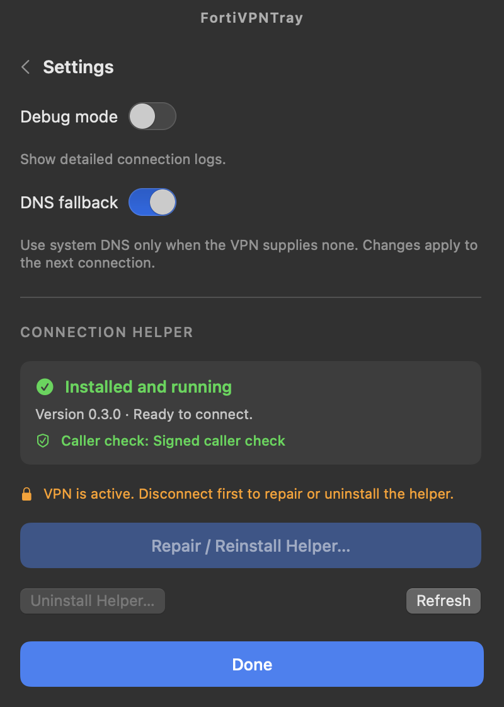

# FortiVPNTray

A lightweight, native macOS menu bar client for [openfortivpn](https://github.com/adrienverge/openfortivpn), built with **SwiftUI and AppKit**, for gateways that use **SAML** single sign-on (for example Microsoft Entra ID).

Connect, sign in through your browser, close the window, and keep your VPN in the menu bar.

[Build details](native/README.md) · [Local signing](docs/signing.md) · [MIT license](LICENSE)

<p align="center">
  
  
</p>

*Screenshots use simulated connection data.*

## Features

- **Menu bar first:** closing the window removes the running Dock icon while the VPN stays connected. Reopen it from the menu bar.
- **Visible connection state:** a green filled checkmark shield when connected, an outline shield when disconnected, and distinct connecting/error icons.
- **Live traffic:** VPN IP, connection duration, download/upload rates, session totals and a two-minute traffic chart in both the window and tray popover.
- **Multiple profiles:** SAML sign-in through the browser, optional realms. There is no password authentication and nothing is stored in Keychain.
- **Certificate pins:** SHA256 pins per profile. An untrusted gateway certificate is shown with its fingerprint and pinned only after you confirm it.
- **DNS:** the VPN's DNS servers and search domains are applied for the session; with DNS fallback on, the system resolvers are kept when the VPN supplies none.
- **Root helper with a narrow interface:** the app sends only a validated connection request; the helper builds openfortivpn's configuration itself, runs its own root-owned copy of openfortivpn, and undoes routes and DNS on every way a session ends.
- **Connection logs:** openfortivpn's output, with the session cookie, SAML ids and URLs redacted by the helper before the app sees it.

## Requirements

- **macOS 13 or later, Apple Silicon.** Intel builds are not supported.
- [Homebrew](https://brew.sh) `openfortivpn` at `/opt/homebrew/bin/openfortivpn` **when the helper is installed or repaired**. The helper copies it and the OpenSSL libraries it loads into a root-owned directory and only ever runs that copy; Homebrew's files are not used while connected.
- To build: **Swift 6+** via Xcode or Command Line Tools.

```bash
brew install openfortivpn
```

## Gateway requirements

These are settings on the FortiGate side; the client cannot work around them.

- **SAML:** the gateway's SAML SP entity ID and ACS URL must use the SSL VPN host and port, for example `https://vpn.example.com:10443/remote/saml/login`. Without the port the login lands on `:443`, and the browser is never sent back to the local listener that openfortivpn waits on. FortiClient's embedded browser still works in that case, which hides the problem.
- **Split DNS:** push the internal domains as the SSL VPN DNS suffix (several separated by `;`). Without a suffix the VPN resolver is registered as a catch-all and loses to other catch-all resolvers, such as Tailscale's.
- **No public resolvers:** don't push a public resolver (for example `8.8.8.8`) as a VPN DNS server. It can answer internal names with NXDOMAIN, and internal lookups leak to it.
- **Safari:** with iCloud Private Relay or "Limit IP address tracking", Safari may bypass split DNS for internal names under a public domain. `.local` names are not affected.

## Build and run

This fork is built from source; it publishes no release downloads. From the repository root:

```bash
native/scripts/test.sh
native/scripts/build.sh
open native/dist/FortiVPNTray.app
```

Build outputs:

- `native/dist/FortiVPNTray.app`
- `native/dist/FortiVPNTray-native-arm64.zip`

The app is **never Apple-notarized**. Without further setup it is **ad-hoc signed**, which makes the helper fall back to checking only your user ID (**UID-only**: any process running as you can use it). For daily use, sign with a local self-signed identity so the helper accepts only this app; see [docs/signing.md](docs/signing.md):

```bash
FVT_SIGN_IDENTITY="FortiVPNTray Local Signing" native/scripts/build.sh
```

If the selected Xcode installation is unavailable, select an installed Command Line Tools toolchain for the command, for example:

```bash
DEVELOPER_DIR=/Library/Developer/CommandLineTools native/scripts/build.sh
```

The [app CI workflow](.github/workflows/ci-app.yml) tests and builds the Apple Silicon app when `native/` changes; a [general workflow](.github/workflows/ci-general.yml) runs file, workflow and secret checks on every pull request and on `main`. CI publishes nothing: no artifacts, no GitHub Releases.

## First connection

1. Open **Settings** and choose **Install Helper…**. Approve the macOS administrator prompt, then wait for **Installed and running**. Settings shows which **caller check** the helper uses: *Signed caller check*, or *UID-only* with a warning for an ad-hoc signed build.
2. Create a profile with the gateway host, port and, if your gateway needs one, the realm.
3. Select the profile and click **Connect**, then sign in in the browser window that opens. If asked to trust a certificate, verify its SHA256 fingerprint with your administrator before confirming.
4. Close the window to keep the VPN in the menu bar. Click the tray icon for statistics and **Disconnect**; **Open Window** restores the window and Dock icon.

**Quit** disconnects the active session before exiting. Repairing or uninstalling the helper requires disconnecting first; refreshing its status is available while connected. Uninstalling the helper keeps your profiles.

After `brew upgrade` changes openfortivpn or OpenSSL, choose **Repair / Reinstall Helper…** to copy the new version; until then the helper keeps using its working copy.

## Architecture and data

| Component | Implementation |
| --- | --- |
| Desktop window and tray | SwiftUI + AppKit, `native/Sources/FortiVPNTray` |
| Profiles, settings, helper client and installer | Swift `FortiVPNCore` |
| Shared protocol types, validation, log parsing | Swift `FortiVPNShared` |
| Privileged helper | Swift `FortiVPNHelper`, an XPC Mach service run by launchd as root |
| VPN protocol engine | External `openfortivpn` (GPLv3), copied from Homebrew at install time, never bundled |

The helper accepts connections only from your user ID and, with a locally signed app, only from this app's certificate. It validates every request itself, writes openfortivpn's configuration file with fixed arguments, checks its copy of openfortivpn and the libraries against their recorded hashes before every start, and removes the routes, DNS settings and pppd it set up when the session ends, after a crash, or after sleep.

- App and configuration identifier: `eu.dvad.fortivpntray` (profiles in `~/Library/Application Support/eu.dvad.fortivpntray`).
- Helper: `eu.dvad.fortivpntray.helper` at `/Library/PrivilegedHelperTools/eu.dvad.fortivpntray.helper`, job `/Library/LaunchDaemons/eu.dvad.fortivpntray.helper.plist`.
- openfortivpn copy: `/Library/PrivilegedHelperTools/eu.dvad.fortivpntray.helper.d`.
- Helper state: `/Library/Application Support/eu.dvad.fortivpntray.helper`.
- Helper logs: the unified log, `log stream --predicate 'subsystem == "eu.dvad.fortivpntray.helper"'`; session output is kept in memory only.

Run only one FortiVPNTray instance, and do not connect another VPN client concurrently: the helper manages a PPP interface, DNS and routes.

## Development and validation

Open `native/Package.swift` in Xcode, or use the scripts above. Always use `native/scripts/build.sh` when producing a complete app bundle with its helper.

An isolated UI smoke check is available in a logged-in macOS desktop session:

```bash
native/dist/FortiVPNTray.app/Contents/MacOS/FortiVPNTray --smoke-test
```

It uses temporary configuration and simulated telemetry, checks window/tray/Dock behavior, and exits automatically without contacting the live helper. The unit tests use fakes for the helper, processes, routes and DNS; they never establish a VPN connection or change the system.

Automated tests and builds do not replace testing against your SAML gateway, corporate DNS, sleep/wake behavior or macOS version. See [native/README.md](native/README.md) for validation details.

## Credits and license

This is a fork of **[FortiVPNTray](https://github.com/itstone/FortiVPNTray)** by **itstone** (from v0.2.3), a native Swift rewrite derived from **[OpenFortiVpn Connect](https://github.com/walcew/openfortivpn-connect)** by **Wallacy Santos Ferreira**. The fork replaces the original connection helper with a new Swift helper and keeps the original MIT attribution. The VPN engine is **[openfortivpn](https://github.com/adrienverge/openfortivpn)** by Adrien Vergé and contributors. The original profile-oriented interface was inspired by OpenVPN Connect.

This repository is licensed under the **[MIT License](LICENSE)**. External dependencies retain their own licenses; openfortivpn (GPLv3) is installed by you through Homebrew and is never included in the app or its archive.

This project is independent and is not affiliated with or endorsed by Fortinet, FortiClient, FortiGate or OpenVPN. Product names and trademarks belong to their respective owners.
